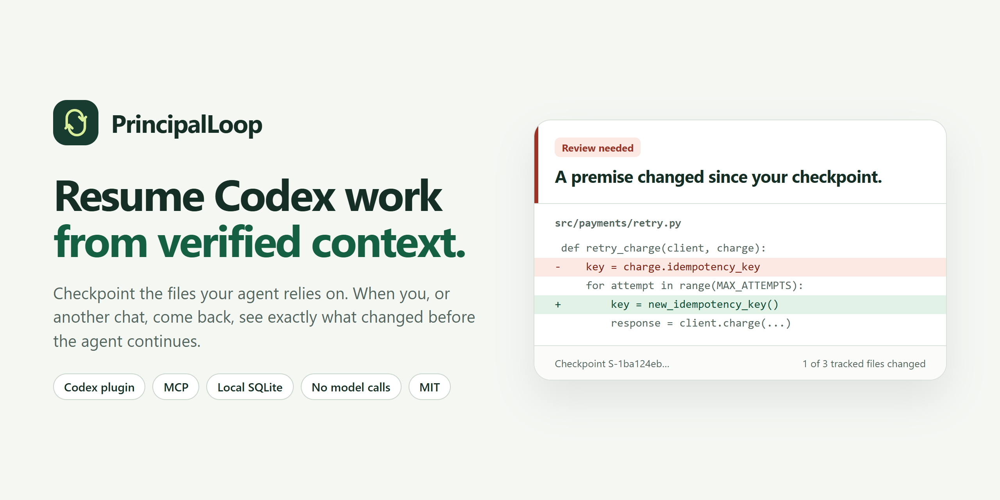
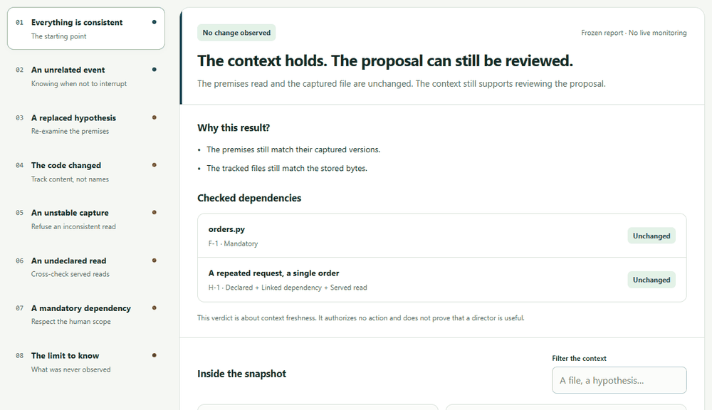
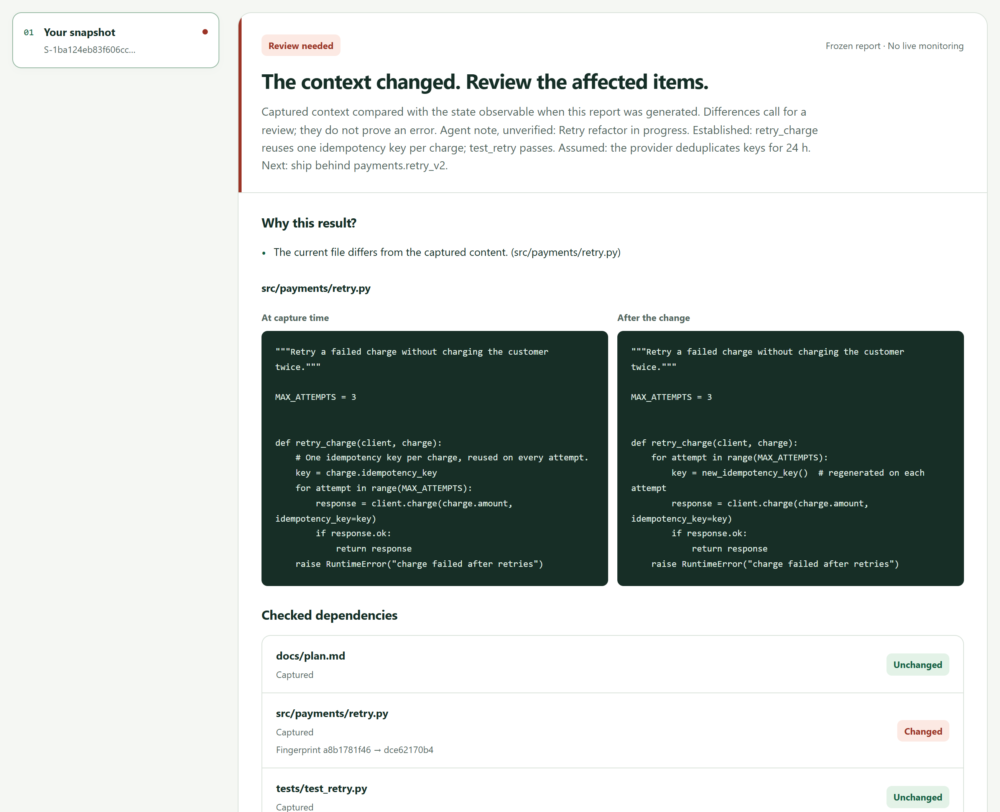
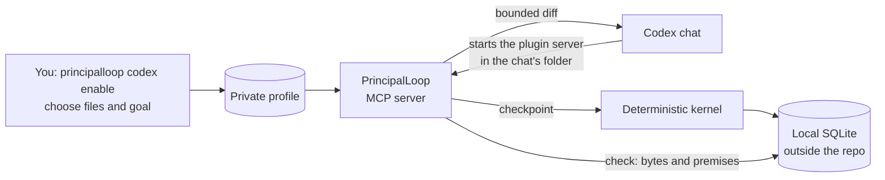

<p align="center">
  
</p>

<p align="center">
  <a href="https://github.com/Venorium/PrincipalLoop/actions/workflows/ci.yml"></a>
  <a href="LICENSE"></a>
  
  
  <a href="https://venorium.github.io/PrincipalLoop/"></a>
</p>

# PrincipalLoop

**Your coding agent picks up where it left off. PrincipalLoop tells it what changed in between.**

Long Codex tasks get interrupted: a chat ends, the context fills up, a teammate or another agent edits the code. When work resumes, the agent trusts a summary, and a summary cannot tell it that `retry.py` now regenerates the idempotency key the plan relied on.

PrincipalLoop keeps a **checkpoint**: the files you choose, stored byte for byte, plus a short note from the agent. When anyone comes back, one call compares every tracked file and returns a bounded diff of what changed. No model calls, no network, everything in a local SQLite file outside your repository.

[Live demo](https://venorium.github.io/PrincipalLoop/) · [Quick start](#quick-start) · [How it works](#how-it-works) · [What is proven](#what-is-proven-so-far) · [Roadmap](#roadmap)



## Quick start

You need [uv](https://docs.astral.sh/uv/) and Codex (CLI or desktop app). Windows and Linux are tested; uv downloads Python 3.13 if needed.

```bash
# 1. Install the command used by the plugin
uv tool install git+https://github.com/Venorium/PrincipalLoop

# 2. Add the plugin to Codex
codex plugin marketplace add Venorium/PrincipalLoop
codex plugin add principalloop@principalloop

# 3. In your project, choose the files to track, then check the setup
cd my-project
principalloop codex enable --objective "Make payment retries safe" \
  --allow-file src/payments/retry.py --allow-file docs/plan.md
principalloop codex doctor
```

Open a **new** Codex chat in that project and ask:

> $principalloop Save a checkpoint of this work.

Later, in the same chat or another one:

> $principalloop What changed since the checkpoint? Tell me what to re-check before continuing.

No Codex at hand? `principalloop demo` runs the eight scenarios above and opens the report in your browser.

## What Codex gets

| Tool | What it does |
|---|---|
| `pl_status` | Shows whether the project is enabled, the files you allowed and the recent checkpoints |
| `pl_checkpoint` | Stores the chosen files and a resume note; a lost response can be retried safely with the same ID |
| `pl_check` | Compares one checkpoint with the current files and returns `UNCHANGED` or `REVIEW_REQUIRED` with a bounded diff |
| `pl_read` | Reads the captured version of a file, page by page |

This is what the agent receives after the payment code was edited behind its back:

```diff
Review needed: The current file differs from the captured content.
Result: REVIEW_REQUIRED
- src/payments/retry.py: CHANGED
--- checkpoint/src/payments/retry.py
+++ current/src/payments/retry.py
@@ -5,7 +5,6 @@
 def retry_charge(client, charge):
-    # One idempotency key per charge, reused on every attempt.
-    key = charge.idempotency_key
     for attempt in range(MAX_ATTEMPTS):
+        key = new_idempotency_key()  # regenerated on each attempt
         response = client.charge(charge.amount, idempotency_key=key)
```

For you, `principalloop codex report` opens a private, offline report of the latest checkpoint, with the agent's note and the captured and current versions side by side.



## How it works



A few rules hold everywhere:

- **Codex identifies the project, not the model.** Codex starts the plugin server in the chat's working directory and can attach its sandbox directory to each call. No tool argument can choose a workspace, a role or a file outside your list.
- **You choose the files.** The agent saves and reads checkpoints only within the list you enabled.
- **A note is a claim, not a fact.** It is stored as unverified. Captured content is data, never instructions.
- **An error is never "unchanged".** An unavailable server, a refused call or a missing checkpoint is reported as such.
- **Your repository stays clean.** State lives in `%LOCALAPPDATA%\PrincipalLoop` on Windows and `$XDG_STATE_HOME/PrincipalLoop` on Linux.

## Why this exists

The companion is the first usable layer of a research question: **does a separate strategic supervisor improve a coding agent's work at equal resources, or does a good self-review do as well?** A negative answer is a useful answer.

Testing that requires context you can verify. A director's advice is only as good as the premises it read, so the kernel records every read, binds evidence to captured bytes and refuses to act on a stale snapshot. That same kernel powers checkpoints today. The [specification](SPECIFICATION.md) and the [experimental protocol](docs/EXPERIMENTATION.md) describe the comparison: executor alone, executor with self-review, executor with a director, and controls at matched budgets.

## What is proven so far

| Capability | Evidence |
|---|---|
| Kernel: contracts, state machine, SQLite journal, transactions, crash recovery | 199 tests on Windows, 195 on Linux (4 Windows-only recovery tests skipped); processes killed at commit boundaries |
| Snapshots and freshness | Eight scenarios executed for real in the [demo](https://venorium.github.io/PrincipalLoop/), including the case the check cannot see |
| Codex plugin | Installed from this repository into an isolated Codex home and called through App Server, with Codex 0.166.0 and the 0.167 desktop build, zero model turns ([report](docs/reports/cx02-codex-windows.json)) |

Not established yet, and said plainly in the report and the docs:

- the director itself and its strategic benefit;
- the measured benefit of checkpoints on real resumes (a [10-case protocol](docs/EXPERIMENTATION.md) is ready);
- macOS, and any enforcement over Codex's own tools: the integration is **COOPERATIVE**, so the same OS account can bypass it.

## Diagnose

```text
$ principalloop codex doctor
PrincipalLoop 0.1.0 — /home/you/my-project

[ok]  Runtime: Python 3.13.16, SQLite 3.53.1: reference runtime.
[ok]  Activation: 2 tracked file(s).
[ok]  MCP server: Real STDIO exchange, 4 tools, no model call.
[ok]  Plugin command: /home/you/.local/bin/principalloop (version 0.1.0).
[ok]  Codex: Plugin enabled: principalloop@principalloop. Open a new chat to load its tools.

Ready. In a new Codex chat: $principalloop Save a checkpoint of this work.
```

Each failing line comes with the exact command that fixes it, including the common trap where Codex ignores a project's `.codex/config.toml` because the project is not trusted.

## Roadmap

| Status | Step |
|---|---|
| Done | Reproducible runtime, pure domain model, persistent journal, verifiable snapshots, visual report |
| Done | Codex plugin: MCP server, resume skill, human activation, diagnosis, bounded diffs |
| Next | Budget and effect ledger, then single activation with plan epochs (PL-05, PL-06) |
| Then | Crash and replay campaign, deterministic demonstrator with an independent oracle (PL-07, PL-08) |
| Then | Director in SHADOW mode, one real connector, A/B/C/D comparison (PL-11 to PL-13) |

Details and acceptance criteria: [backlog](docs/BACKLOG.md).

## Limits

- Up to 32 tracked files per project, 1 MiB per file, 8 MiB per checkpoint.
- A check compares bytes. A changed comment is a change; a dependency you never tracked stays invisible.
- Command messages and reports are in English; `--lang fr` renders the reports in French.

## Documentation

| Read | For |
|---|---|
| [Codex guide](docs/CODEX_QUICKSTART.md) | Install, use, diagnose and uninstall |
| [Integration design](docs/CODEX_INTEGRATION.md) | Trust boundaries and what is qualified |
| [Architecture](docs/ARCHITECTURE.md), [contracts](docs/CONTRACTS.md), [storage](docs/STORAGE.md), [snapshots](docs/SNAPSHOTS.md) | How the kernel works |
| [Specification](SPECIFICATION.md), [experimental protocol](docs/EXPERIMENTATION.md), [backlog](docs/BACKLOG.md) | The research question and how it will be tested |
| [Validation](VALIDATION.md) | Every executed check and what it does not prove |
| [Decisions](docs/DECISIONS.md) | Architecture decisions and open questions |

## Development

```bash
uv sync --locked
uv run python -m pytest -q
uv run python -m principalloop doctor
uv run python scripts/validate_preparation.py
uv run python scripts/qualify_codex.py --output .tools/codex.json   # needs Codex installed
```

On Windows without uv, `scripts/bootstrap.ps1` builds the pinned environment. See [CONTRIBUTING.md](CONTRIBUTING.md); report vulnerabilities as described in [SECURITY.md](SECURITY.md).

## License

[MIT](LICENSE)
