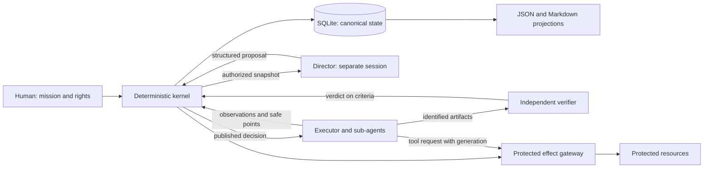
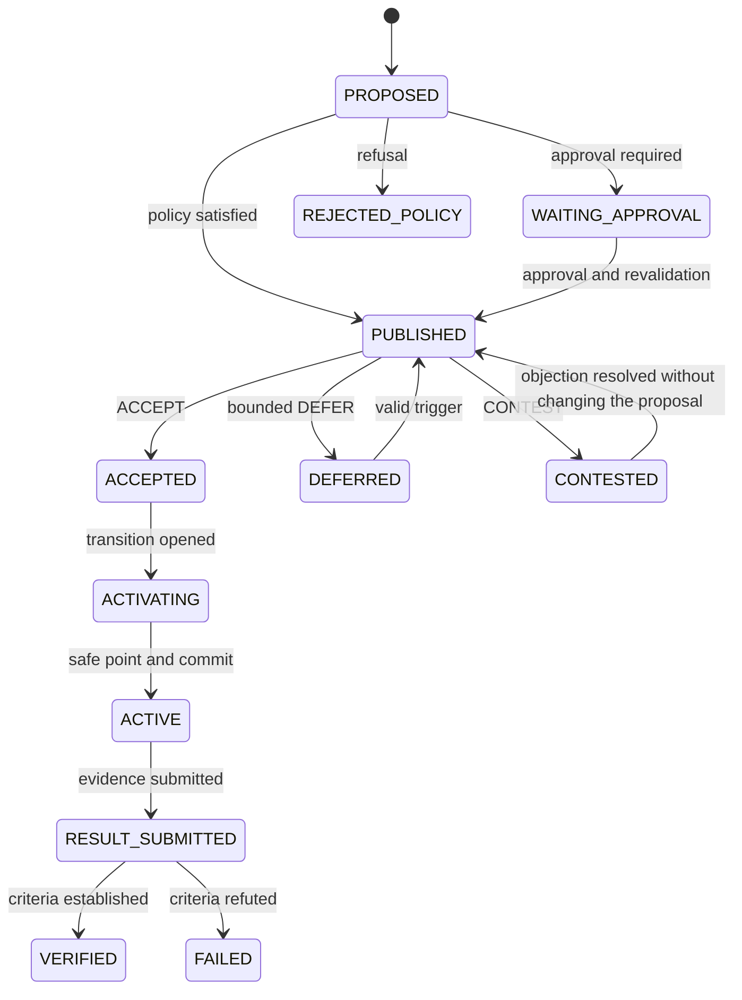

# Detailed architecture

Status: target architecture, 4 October 2026. PL-01/02 deliver the qualified runtime and the pure domain described in [CONTRACTS.md](CONTRACTS.md). PL-03 delivers their [transactional storage](STORAGE.md) and PL-04 the [snapshots and visual reports](SNAPSHOTS.md). The other components are still to be built; the [Codex path](CODEX_INTEGRATION.md) bounds the proposed integration. This document complements [SPECIFICATION.md](../SPECIFICATION.md). Open choices live in [DECISIONS.md](DECISIONS.md).

## Boundaries and flows

The director only has the authorized reads and the typed submission. The kernel authenticates calls; an `author` or `authority_requested` field creates no power. Documentary projections can be consulted; they are never re-ingested as authorized commands.

The gateway becomes a guarantee only if **every** access to the protected resource goes through it. In the simulator, tools can be fully controlled. In a real shell with the same rights as the kernel, the mode stays COOPERATIVE until isolation is demonstrated.

## Minimal breakdown

Keep the proposed modular Python monolith. `src/principalloop/domain/` and `store/` exist; the other modules below are a target. `runtime.py` currently qualifies Python/SQLite and does not adapt a runner.

| Target module | Responsibility | Forbidden dependency |
|---|---|---|
| `domain/` | Types, preconditions, pure transitions | SQLite, network, model, global clock |
| `policy/` | Authority, scope, freshness, admission | Probabilistic decision by a model |
| `store/` | Journal, views, constraints, outbox, transactions | Long call inside a transaction |
| `snapshot/` | Immutable capture, manifest and served reads | Silently inconsistent capture |
| `scheduler/` | Triggers, deadlines, batching | Treating a timer as a mandatory LLM call |
| `mailbox/` | Delivery, receipt, response and deduplication | Using a cursor as a processing acknowledgement |
| `runtime/`, `collector/` | Capabilities, observations and safe points | Assuming a missing capability |
| `director/` | Context, typed output, cost and bounded retry | Writing code or authorizing an action |
| `verification/` | Criteria and evidence for the result | Confusing conformance with causal benefit |
| `presentation/` | CLI, later local API, exports | Becoming a second source of truth |

Start with in-memory functions and interfaces. Add modules ticket by ticket; no empty folders meant to simulate progress. FastAPI/httpx remain useful for a later multiprocess interface, with no obligation to put them in the first domain test.

## Objects and contracts

The initial shapes below are delivered in PL-02; their ingestion, persistence and full semantic validation follow the relevant tickets. The effect intent contract covers INTENDED only; the registry and the effect completion evidence belong to PL-05. The event is a client submission, not the canonical format of the future journal.

| Future contract | Minimal fields and rules |
|---|---|
| Mission | Project, revision, objective, criteria, scope, mandatory constraints, actions, sources, budgets and escalations |
| Event | ID, project, type, schema version, bounded content, causality; producer assigned by the transport; sequence and reception assigned by the kernel |
| Snapshot | ID, journal cut, mission/policy/epoch, object revisions, artifact manifest, stability state |
| Director turn | Run, snapshot, prompt/model/configuration versions, reads, outcome `NO_CHANGE` or `PROPOSE`, optional proposal, documentary patch and consumption |
| Checkpoint | Worker/run/lease, epoch, tasks and effects in flight, quiescence state, artifact references |
| Result | Decision, execution epoch, artifacts, criteria, control report; verifier identity assigned by the transport |
| Effect intent | Stable action ID, resource, preconditions, generation, idempotency key, state, result evidence or uncertainty |

The existing proposal/response shape stays at v0.1. The director envelope must forbid `NO_CHANGE` with an active proposal and require exactly one proposal for `PROPOSE`. A schema defect must not turn into `NO_CHANGE`: record a contract failure, with at most one repair retry offered up front and billed.

The documentary patch is also versioned and bounded: allowed objects, expected revision, provenance and valid relations. It cannot modify a mission or a policy. Apply the patch in a separate, identified transaction; if the patch changes the premises of an attached proposal, revalidate the proposal or request a new turn. Never publish from a fictitiously updated snapshot.

A patch cannot claim the verifier's identity or its validation status. The kernel keeps the real author and the sources of every assertion; a model summary does not turn a reported observation into independent evidence. The epistemic statuses and the rights to change them are tested in PL-02/PL-04.

## Versions, identity and freshness

`mission_revision` and `policy_revision` bound authority. `plan_epoch` bounds the plan; it is global to the project in the MVP. `decision_revision` protects the lifecycle of a decision. `event_seq` is a position in the journal, not a universal invalidation counter.

At a minimum the kernel checks: known project and parent goal; authorized actor; existing evidence; stable snapshot; compatible mission/policy/epoch; object references unique by ID; matching revisions and digests; deadline not passed; budget reserved; no incompatible concurrent activation.

A syntactically correct `read_set` can omit a real dependency. Proposed handling: record the references served to the director, union them with the ones it declares, add the kernel's mandatory dependencies and keep the provenance of that union. Reject unknown or inconsistent references. A closure over the graph does not discover dependencies that were never modeled: that limit remains and is tracked as X-01 in [TRACEABILITY.md](TRACEABILITY.md).

This union is conservative: a reference that was served but is not decisive can cause a needless invalidation. Measure that case and the context size; do not present this choice as the answer to dependency completeness. Any reduction must preserve the mandatory dependencies and be evaluated separately.

An event with no effect on this set does not make the decision stale. Purely descriptive documentary updates should avoid bumping business revisions without a relevant change; PL-04 keeps the revision for a mere title change; content, relations and sources are semantic.

## Decision lifecycle

The diagram shows the main path. Cross-cutting outcomes and exceptions are defined below; no implicit transition is allowed. A `RECEIVED` event is not an execution state. The P identifier belongs to the immutable proposal; D identifies the published decision. Their mapping is persisted; D is never derived from P's suffix.

| Origin | Outcome/event | Guard and effect |
|---|---|---|
| PROPOSED or WAITING_APPROVAL | Authorization | Publication after revalidation; approval bound to this exact intent |
| WAITING_APPROVAL | Human refusal | CANCELLED, reason kept |
| PUBLISHED | Repeated receipt | Deduplicate the delivery; no change of plan or business revision |
| PUBLISHED | Response | Expected revision and worker checked; a late response does not replace the current state |
| DEFERRED | Trigger or deadline | Back to PUBLISHED if valid; the maximum activation deadline still applies |
| CONTESTED | New information | Bounded resolution; different content = new proposal with a replacement link |
| Non-terminal pre-ACTIVE state | Expiry, invalidation, withdrawal | EXPIRED, STALE or CANCELLED; controlled release of reservations and locks |
| ACTIVATING | Unknown effect | Stay in bounded reconciliation; no ACTIVE commit by assumption |
| ACTIVE | Stop or substitution | Revoke the affected future rights, reach a safe point, reconcile, then close explicitly |
| RESULT_SUBMITTED | Insufficient evidence | Keep the bounded wait or end FAILED with reason `UNVERIFIABLE`; utility INCONCLUSIVE |
| Terminal state | New need | New identifier; never reopen history |

The terminal states are REJECTED_POLICY, STALE, EXPIRED, VERIFIED, FAILED and CANCELLED. A recoverable technical problem is an attempt attached to the current state; its delay and cap are persisted. A cancelled transition does not undo an effect that already happened.

### Trajectory, decision and utility

The trajectory is RUNNING, PAUSED or STOPPED, independently of the decision lifecycle. A PAUSE decision can become VERIFIED once the safe pause is established; it does not hold forever the lock that would prevent RESUME. STOP_BRANCH ends a logical scope and keeps its artifacts, without any Git deletion.

ESCALATE creates an arbitration request and does not activate a new generation by itself. The human response produces an authenticated action or a new proposal. A new mission/policy invalidates the dependent proposals; their revisions are never updated in place to make them acceptable.

In the MVP, only one replanning can be engaged in activation or execution. The others stay in a persisted wait or request a coordinated substitution. A PAUSE/STOP_BRANCH request that targets active work follows this substitution: safe point, closing of the old intent and activation of the new one, without a second concurrent owner. A human stop can immediately revoke the future protected rights.

The director can track at most two open investigations, without opening a second concurrent activation; the simulator tests this ordering. A wait for a safe point or for reconciliation has a deadline: once it passes, the intent is closed or escalated explicitly, unknown effects stay recorded and the affected rights stay blocked. Independent work that was already authorized can continue. These control ports are specified in PL-02.

Utility BENEFICIAL/HARMFUL/NO_MEASURABLE_EFFECT/INCONCLUSIVE is stored separately. VERIFIED means the action's criteria are established; an investigation honestly closed as inconclusive can satisfy its contract without bringing a measurable benefit to the mission.

## Activation transaction

1. Acquire transition ownership for the project and record ACTIVATING, its deadline and the target generation.
2. Request the safe point; wait outside any SQL transaction. In COOPERATIVE, the absence of new starts is declared, not technically guaranteed.
3. Identify the affected workers, leases and effects. Reconcile the unknowns; a missing response remains an unknown.
4. Open a short transaction. Re-read mission, policy, epoch, versions, reservations, transition ownership and effect status.
5. If everything matches, write ACTIVE, increment `plan_epoch` exactly once, consume/attach the reservation and write event + outbox atomically. Otherwise close, or keep the justified wait, depending on the fault.
6. After the commit, publish the new generation. A lost response does not re-run the increment; idempotency finds the recorded result.

The application lock is also recoverable and protected against a former owner that is still alive. Single-writer mode must prevent a second kernel from taking the same database for writing without coordination; a plain file holding a PID is not enough to prove the owner is still valid.

### Example of an expected trace (not executed)

| Step | Data | Expected |
|---|---|---|
| Capture | S-1 at `event_seq=40`, mission 1, policy 1, epoch 3; A-1 revision 2 | P-1 references this snapshot and A-1/2 |
| Noise | Event 41 with no effect on P-1's reads or guards | P-1 stays admissible; 41 > 40 is not enough to invalidate it |
| Contradiction | Event 42 replaces A-1/2 with A-1/3 | P-1 becomes STALE; epoch stays 3 |
| New proposal | P-2 uses S-2 and A-1/3; all guards are satisfied | After publication, response and safe point, ACTIVE and epoch 4 are committed together |
| Crash | Process stopped after this commit, before the notification is delivered | Recovery publishes epoch 4; no move to 5 for the same identifier |

This case links T-03, T-05 and T-06 without confusing premise freshness with journal order. It will be turned into a domain test, then a recovery test; the table is not an experimental trace.

## Persistence, recovery and effects

Proposed constraints: uniqueness of `(project_id, producer_id, event_id)`; uniqueness of idempotency keys per actor/operation/project; uniqueness of a decision's activation; uniqueness of the epoch per project; revision compared on every mutation. The same key with different content is a conflict, never a deduplication success.

Compare commands through a versioned canonical representation after strict validation: sorted keys, list order preserved, kernel-assigned fields excluded, no non-finite values and no duplicate JSON keys. Keep the validated content and its digest. No broader Unicode or business equivalence is assumed.

The accepted event, the current view, the transition, the budget and the related outbox belong to the same transaction. The acknowledgement only follows the commit. Replay rebuilds the views from **accepted, versioned** events; it re-runs neither model proposals nor effects. Unknown events from a future version stop the replay explicitly.

For effects: `INTENDED` → `DISPATCHED` → `CONFIRMED`, `REJECTED` or `UNKNOWN`. Persist the intent before dispatch. After a crash, a `DISPATCHED` without a result is UNKNOWN until the resource is consulted, an idempotent repeat is demonstrated or an arbitration happens. Fencing must be checked at the boundary that performs the effect, not only when the intent is created.

The projection manifest references immutable files and their digests. The manifest is published after they exist; reads use a complete generation; an incomplete generation is never used. A capture of files that are changing is marked unstable, or redone from a frozen copy. File recovery is tested on Windows and Linux before portability is claimed.

SQLite stays on a local disk. Require a patched version and publish the loaded version, the pragmas actually applied, the hardware and the scenario when measuring. The WAL guarantees and limits come from the [SQLite documentation](https://www.sqlite.org/wal.html); they are not a PrincipalLoop test result.

## Time, budget and degraded modes

Use an injectable clock: monotonic time for a duration within a process, persisted UTC deadlines for recovery. Never use an agent-supplied `observed_at` for ordering or authority. On an ambiguous clock jump, keep sensitive actions waiting rather than silently extending an authorization.

Reserve a maximum of input + output + any billed but invisible tokens (depending on the provider) before the call. Count retries and investigation calls. A timeout does not release a reservation whose cost is still unknown. A local request cap is not a guarantee of a billing cap without a demonstrated provider capability.

| Situation | Expected behavior |
|---|---|
| SHADOW | Turns, patches and proposals recorded in a separate observation space; no executable message, no trajectory mutation and no supervision data fed back into the executor's context |
| Director unavailable | The last authorized trajectory continues; degraded supervision is visible |
| Kernel unavailable | ENFORCED refuses new protected effects; COOPERATIVE does not claim to prevent direct access |
| Budget exhausted | No new unprovisioned call; record and finish the computations already engaged according to the contract |
| Export unavailable | Canonical state intact; export retried without a new strategic turn |
| Invalid model output | Contract failure distinct from non-intervention, bounded retry then explicit status |

## Contract of the future connector

The capability report contains the runner version, observation, delivery, receipt, safe points, interruption, tool control, effect control, test evidence and limits. An `unknown` or `unsupported` value is better than a simulated success.

The full bridge comes before the director connector. At the maintainer's request, CX-01 then CX-02 anticipate a bounded context facade, without activation, distributed as a Codex plugin: [delivered contract](CODEX_INTEGRATION.md). For Codex, the documentation exposes steering and turn interruption; that does not attest the tool coverage of a local installation. See [OpenAI — App Server](https://learn.chatgpt.com/docs/app-server). The reserved verifier folders and the kernel state must be inaccessible to the evaluated agents in a future isolated campaign, including through delegated tools; CX-01 does not provide that system isolation.

## PL-04 implementation and remaining boundary

`snapshot/` separates documents, bounded file reading, capture/revalidation, scenarios and the HTML projection. The immutable contents live in SQLite; the manifest and its BLOBs are committed with the journal/outbox. Format 2 migrates v1 without changing the old receipts. Snapshots are not executable worktrees.

Freshness is derived from the real state by `Store.apply`. The budget, safe point, effect and independent judgement attestations are still to be built. File comparison is a bounded local read; no model call, verifier callback or network wait happens inside the transaction. The verifier works on the bytes captured before the transaction that archives its evidence.

The HTML is self-contained, with no server and no network dependency; editing it does not affect canonical control. The real report inspects a capture without claiming to evaluate a proposal. The demo runs eight freshness scenarios and makes visible the case where a never-observed dependency escapes control. This presentation answers the maintainer's request to make the product understandable at a glance.

## CX-01/CX-02 implementation

CX-02 adds plugin mode: with no profile pinned by configuration, the server identifies the project from its start directory, or from the `sandboxCwd` that Codex attaches to the call, then from the closest enabled ancestor (ADR-19). `pl_check` attaches a bounded unified diff. The kernel, its formats and its contracts are unchanged.

`codex/` separates the STDIO transport, operations, human profile, reversible installation and skill instructions. The transport has no generic route to `Store.apply`, mission initialization or effects. The capture role is derived from the configured channel; a model argument cannot assign it. The human installation initializes a context mission with no model budget if no mission exists; it keeps an existing mission.

Each capture briefly takes the existing OS lock, then closes the owner. Three independent clients are exercised; no conforming simultaneous writer is allowed. Checks and reads use `Reader`. This refinement of ADR-12/13 avoids a permanent service for context alone; it will have to give way to the PL-09 coordinator before the scheduler and activations. An optional note and a capture comparison without a proposal reuse SQLite format 2, without changing the normative contracts.
