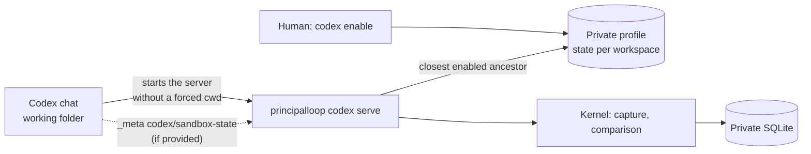

# Codex integration: context plugin delivered, director still to build

**CX-02 distributes the context companion as a Codex plugin.** The repository catalog (`.agents/plugins/marketplace.json`) publishes `plugins/principalloop`: manifest, STDIO MCP server and resume skill. The human enables a project by choosing its files; Codex designates the project of each call. The [guide](CODEX_QUICKSTART.md) covers installation and use.

CX-01 had delivered the same surface through a project configuration. Codex ignores that configuration when the project is not trusted, which made it silently inoperative on a real machine. The plugin removes this dependency; project mode remains available and diagnosed. The project's goal is still to measure whether separate supervision improves the work at comparable resources.

## Delivered contract

| Tool | Model inputs | Result |
|---|---|---|
| `pl_status` | None | Activation, recognized project, allowed files, five recent checkpoints |
| `pl_checkpoint` | Request ID, note, chosen allowed files | Immutable capture; the same ID and the same arguments return the same receipt |
| `pl_check` | Exact capture ID | `UNCHANGED` or `REVIEW_REQUIRED`, reasons, affected items, bounded unified diff |
| `pl_read` | ID, captured path, optional offset | 4,000 characters of the old UTF-8 bytes |

The inputs are closed: no role, workspace, budget, shell command or activation order. Results combine readable text and structured data. The MCP surface (titles, descriptions, messages) is in English; the skill asks the model to answer in the user's language. Errors return `isError` with a code and a fixed hint, without local paths or SQL text.

The diff goes from the captured bytes to the current content, read with the same checks as a capture: allowed path, regular file, 1 MiB at most. It is limited to 3,000 characters per file and 6,000 per call; a non-UTF-8 file has no diff, and `pl_read` remains available. These contents are untrusted data.

## Who designates the project

The plugin's `.mcp.json` sets no `cwd`. Codex then starts the process in the session's working folder and restarts it when that folder changes; the Codex source code shows this (`LocalStdioServerLauncher` and its `fallback_cwd`). The server also declares the experimental `codex/sandbox-state` capability: when Codex attaches `sandboxCwd` to a call's metadata, that folder is preferred. Both channels come from the Codex client; no tool argument is read for this.

From that folder, the server walks up towards the root and keeps the first ancestor that has an activation profile in the default private state. A chat opened in `src/` therefore finds the project. Without a profile, `pl_status` describes the activation command and the other tools fail with `NOT_ENABLED`. The profile is re-read on every call: a new restriction also applies to old captures.

The inversion test bounds this guarantee. A model does not choose the project through an argument, but an agent that runs commands under the same account can start the server elsewhere or read the private state: coverage stays COOPERATIVE. By contradiction, refusing every subfolder would make the plugin unusable in real repositories; the closest enabled ancestor is the narrowest rule that stays usable.

## Processes and state ownership

Each capture briefly takes the kernel's OS lock, then closes its `Store` (ADR-18). Several MCP servers, one per chat, coexist without simultaneous writers; reads go through `Reader`. The wait is bounded to ten retries of 100 ms before any transaction. This choice suits short context operations; future supervision with budgets and in-flight operations will go through a single coordinator service (PL-09).

The human installation initializes, if needed, a context mission with no model budget. `codex enable` updates the selection while keeping the installation's identity; `codex disable` only removes the profile. The skill text has a single source, `plugins/principalloop/skills/principalloop/SKILL.md`, packaged into the wheel for project mode.

## Interfaces and evidence

The [qualify_codex.py](../scripts/qualify_codex.py) script reproduces a user's path in a temporary `CODEX_HOME`: activation through the installed command, `codex plugin marketplace add` on this repository, `codex plugin add`, then App Server. Three threads start in the project, in a subfolder and in a project that is not enabled. Calls go through `mcpServer/tool/call`, without `turn/start` and without copied authentication; temporary paths are removed from the report.

| Capability | Demonstrated state |
|---|---|
| Plugin installation from this repository | Run with Codex CLI 0.166.0 and desktop 0.167.0-alpha.3.2 |
| Server started by the plugin, four tools, `codex/sandbox-state` capability recognized | Run |
| Project resolved from the chat folder and from a subfolder | Run; observed channel: the process folder |
| `sandboxCwd` in call metadata | Unit tested; not observed through `mcpServer/tool/call` |
| Project not enabled | `NOT_ENABLED` refusal, never `UNCHANGED` |
| Capture, noise, change with diff, historical bytes, retry | Run in both modes |
| Project mode (trusted configuration) | Run |
| Real desktop chat with a model | Not qualified here: no model turn |
| Director, monitoring, proactive delivery, interruption | Not delivered |
| Control of Codex tools and effects | None: COOPERATIVE context coverage |
| Benefit on real resumes | Not established; [pilot](EXPERIMENTATION.md) ready |

The [CX-02 report](reports/cx02-codex-windows.json) keeps versions, checks, methods and durations. The durations are descriptive: a tool call takes roughly 5 to 25 ms, and the first call of a new chat about 300 ms including server startup. This is neither a p95 benchmark nor a measurement of model cost.

Sources: [Codex plugins](https://developers.openai.com/plugins/build/plugins), [plugin.json specification](https://github.com/openai/skills/blob/main/skills/.system/plugin-creator/references/plugin-json-spec.md), [Codex MCP](https://learn.chatgpt.com/docs/extend/mcp?surface=cli), [App Server](https://learn.chatgpt.com/docs/app-server), MCP [transports](https://modelcontextprotocol.io/specification/2025-11-25/basic/transports) and [tools](https://modelcontextprotocol.io/specification/2025-11-25/server/tools), and the [openai/codex](https://github.com/openai/codex) source code, consulted on 10 November 2026.

## Towards a useful director

The target path remains: principal checkpoint → review provisioned by the scheduler → separate director in SHADOW → `NO_CHANGE` or a structured proposal → kernel check → consultation at the safe point. The principal keeps the code and its sub-agents. A proposal that needs human authorization waits for it; no director message grants it.

PL-05/06 bring budget, effects and decisions; PL-07/08 test recovery and scenarios; PL-09/10 add the service and cadence; PL-11/12 connect the director without giving it the principal's write tools. The publication will also have to show a director that is wrong and a situation where it stays silent.

A kept summary can reproduce the principal's mistake; the bytes and the diff give support that is independent of the narrative, without proving its completeness. Treating every change as an error would make the tool unusable from the first edit: the output therefore asks for a targeted review.
