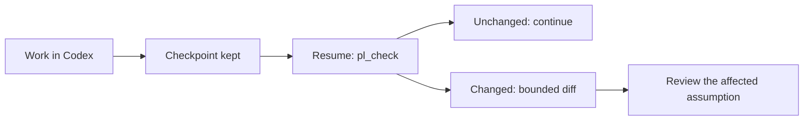

# PrincipalLoop in Codex

**Find where you left off, then check what changed before you continue.** The PrincipalLoop plugin adds four MCP tools and a resume skill to Codex. The files you choose are kept byte for byte; the agent's note stays an unverified statement. The strategic director comes later.

## Install

You need [uv](https://docs.astral.sh/uv/) and Codex (CLI or desktop app), on Windows or Linux.

```bash
uv tool install git+https://github.com/Venorium/PrincipalLoop
codex plugin marketplace add Venorium/PrincipalLoop
codex plugin add principalloop@principalloop
```

The first command installs `principalloop`, which the plugin launches; uv downloads Python 3.13 if needed. If `principalloop` is not found, run `uv tool update-shell`, then restart the terminal and Codex. The next two commands register this repository's catalog and install the plugin for both the CLI and the desktop app. Once the catalog is added, the app can also install the plugin from its plugin directory. Nothing is written into your projects ([plugin format](https://developers.openai.com/plugins/build/plugins)).

## Enable a project

From the project root, choose the tracked files and the objective:

```bash
principalloop codex enable --objective "Make payment retries reliable" \
  --allow-file src/payments/retry.py --allow-file docs/plan.md --allow-file tests/test_retry.py
principalloop codex doctor
```

The profile, the notes and SQLite live in `%LOCALAPPDATA%\PrincipalLoop` or `$XDG_STATE_HOME/PrincipalLoop`, outside the repository. Running `enable` again with another list updates the selection while keeping the installation's identity and the old checkpoints. A file that does not exist yet can be declared; it is reported as missing until it exists.

The choice of files is yours: there is no automatic walk of the whole repository. The technical exclusions cover in particular `.git`, `.codex`, environments, `.env`, links and some secret file names; they do not detect every secret inside an ordinary file. The contents and notes returned over MCP enter the Codex context and follow its data handling settings. Only select files you are willing to share with it.

## Use

Open a **new** Codex chat in the project: a chat that is already open does not necessarily reload its plugins.

> $principalloop Save a resume point for this work with the relevant files, what is established, the assumptions and the next useful check.

When you come back, in this chat or another chat of the **same project**:

> $principalloop Find the checkpoint for this work. What changed? Tell me what to review before continuing.

The skill can also be discovered during a resume or a handoff, but the model is not guaranteed to trigger it; explicit invocation remains the reference path. There is no need for a checkpoint after every small edit.



| Situation | Response |
|---|---|
| Nothing changed in the tracked items | `UNCHANGED`, with the checked ID |
| An untracked file changed | No alert on this checkpoint |
| A tracked file changed or disappeared | `REVIEW_REQUIRED`, path and bounded diff (3,000 characters per file, 6,000 in total) |
| Several chats created checkpoints | Chosen from the note; not automatically the latest |
| Chat opened in a subfolder | The closest enabled project is found |
| Project not enabled | Activation command suggested; no tool claims "unchanged" |
| Server unavailable or call refused | Explicit error, never `UNCHANGED` |

A changed file is not necessarily wrong. An unchanged result proves neither that the context is complete nor that the plan is right. Comparisons work on bytes: a changed comment is also a difference. The MCP tools speak English; Codex answers in your language.

For a visual view of the latest checkpoint, or of a specific ID:

```bash
principalloop codex report
principalloop codex report --snapshot S-... --lang fr
```

The private report opens in the browser: the agent's note, the checked files, and the captured and current versions side by side. It is frozen at generation time. The [public demo](https://venorium.github.io/PrincipalLoop/) lets you explore the viewer without exposing your project.

## Diagnose

`principalloop codex doctor` checks the runtime, the activation, a real MCP exchange, the command launched by the plugin and the Codex configuration. It writes nothing. Each `[X]` line gives the command that fixes it.

| Symptom | Action |
|---|---|
| `pl_*` tools missing in Codex | `codex doctor`, then open a new chat |
| "principalloop not found on PATH" | `uv tool update-shell`, restart Codex |
| Plugin version differs from the diagnostic | `uv tool upgrade principalloop` |
| `NOT_ENABLED` | Enable the project; the model does not choose the files |
| `SCOPE_DENIED` | File outside your selection: run `enable` again with the list you want |
| `WRITER_BUSY` | Another process is writing; retry with the same `request_id` |
| `ID_CONFLICT` | This ID already designates another capture |
| Lost capture response | Same `request_id`, same arguments: the original receipt comes back |

## Project mode, without the plugin

For an environment without plugins, `principalloop codex install` writes a managed block into `<project>/.codex/config.toml` and the skill into `.agents/skills`. Codex loads this configuration **only if the project is trusted**; otherwise it silently ignores it, and `doctor` reports it. The configuration contains absolute paths specific to the machine: keep `/.codex/config.toml` out of Git.

```bash
principalloop codex install --objective "..." --allow-file README.md
principalloop codex uninstall --keep-profile   # move to the plugin while keeping the checkpoints
```

## Rollback

```bash
principalloop codex disable                     # removes the activation; captures and SQLite are kept
codex plugin remove principalloop@principalloop
codex plugin marketplace remove principalloop
uv tool uninstall principalloop
```

No system service or monitoring process is installed. The private state stays in its directory until you delete it manually.

## What is proven

The [qualification report](reports/cx02-codex-windows.json) actually installs the plugin from this repository into an isolated Codex, with Codex CLI 0.166.0 and the 0.167 version bundled with the desktop app. Through App Server, without any model turn, it checks: project resolved from the chat folder and from a subfolder, capture, ignored noise, detected change with diff, historical bytes, identical retry, and a non-enabled project refused without a false "unchanged". The [tests](../tests/test_codex_plugin.py) additionally cover sandbox metadata, hostile arguments, project-mode migration and the diagnostic.

The connector is **COOPERATIVE and limited to context**. It does not monitor continuously, provides no director and does not protect the ordinary Codex tools; the same system account can bypass the facade. Bounds: 32 files, 1 MiB per file, 8 MiB per checkpoint, and a note and read page of 4,000 characters. The real effect of checkpoints on resumes is still to be measured: the [protocol](EXPERIMENTATION.md) defines ten compared situations.
